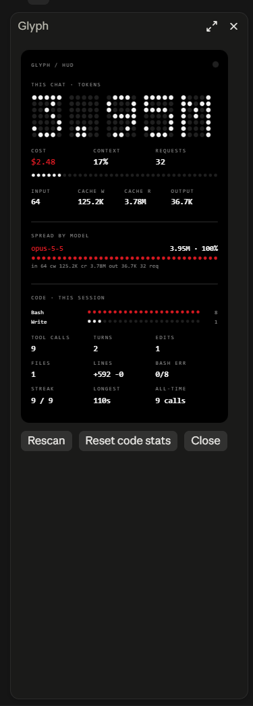

# Glyph HUD

Glyph HUD is a plugin for Claude Code. It shows the token use of the current chat in a dot-matrix pane. The design follows the monochrome dot-matrix style of Nothing devices.

The plugin makes no model calls. It reads local files and the figures that Claude Code already has. It sends no data to any server.



## What the plugin shows

### The pane

The pane opens at the start of each session. The `/glyph` command opens it again.

- **Chat tokens.** The total tokens of the current chat, in large dot-matrix digits.
- **Cost and context.** The cost in US dollars, the context fill as a percentage, and the number of requests.
- **Token types.** Input, cache-write, cache-read and output tokens.
- **Tokens by model.** One row for each model in the chat. Each row shows the total, the share as a dot bar, and the four token types.
- **5-hour limit.** The part of the 5-hour usage limit that is used, as Claude Code reports it. All chats share this limit.
- **Code stats.** Tool calls, the most frequent tools, edits, files, changed lines, Bash errors and the longest turn.

### The status line

The status line under the prompt shows a short summary:

```
◉ 5.14M tok · $2.95 · cache 52:10
```

- `cache 52:10` is the time until the prompt cache expires. The value `cache ● warm` shows during a turn. The value `cache ○ cold` shows after the cache expires.
- While you type a message, the line starts with `✎` and the approximate size of the draft. The plugin uses about 4 characters for each token. It is not an exact count.

### In the terminal

The desktop app shows the pane as an image. The terminal shows the same data as text, with `●` and `·` characters for the dots.

- In the fullscreen layout, the pane opens beside the transcript at the start of a session. The terminal must be 144 columns or wider.
- In a narrower terminal, use the `/glyph` command to open the pane.
- The status line is the same in the terminal and in the desktop app.

## How the plugin counts

### Chat tokens

The plugin reads the transcript file of the chat and the transcript files of its subagents. Each response row records the model and the token use. The plugin counts each response one time.

The count includes the full chat, also the part before the plugin loaded. Requests that the transcript does not record are not in the count. An example is a compaction summary.

### The cache timer

Each request resets the lifetime of the prompt cache. The plugin reads the time of the last response and the cache lifetime from the transcript. The lifetime is 1 hour or 5 minutes.

## Settings

| Setting | Default | Effect |
|---|---|---|
| `blockAttribution` | `false` | Denies `git commit` commands that contain a `Co-Authored-By` trailer. |

Change the setting in the `/config` menu.

## Requirements

- Claude Code 2.1.286 or newer. The plugin API is early access. A later release can change it.
- Python 3 on the `PATH` for transcripts larger than 4 MB. The plugin reads smaller transcripts without Python.

## Install

1. Add the marketplace in Claude Code:

   ```
   /plugin marketplace add MridulNegi2005/glyph-hud
   ```

2. Install the plugin:

   ```
   /plugin install glyph-hud@glyph-hud
   ```

To load the plugin from a local folder, start Claude Code with this flag:

```
claude --plugin-dir path/to/glyph-hud
```

## License

MIT. See [LICENSE](LICENSE).
